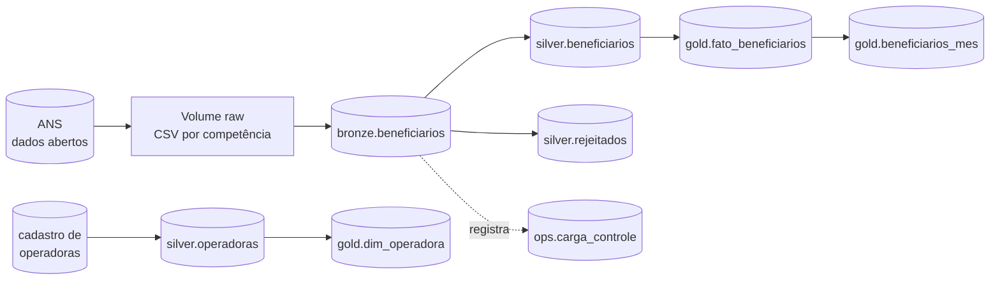

# ANS Beneficiários: lakehouse com PySpark, Delta Lake e Databricks

Pipeline de dados que carrega o arquivo de beneficiários de planos de saúde publicado pela ANS (Agência Nacional de Saúde Suplementar) em um lakehouse no Databricks, organizado em camadas **bronze, silver e gold** com Delta Lake e governado pelo Unity Catalog. Roda no Databricks Free Edition (computação serverless) e é executado por um Job com tentativas automáticas.

É a Fase 4 de um plano de estudos de engenharia de dados:
1. [ans-operadoras-pipeline](https://github.com/AndersonMikaelJr/ans-operadoras-pipeline): ETL com Python e SQLite.
2. [ans-beneficiarios-dw](https://github.com/AndersonMikaelJr/ans-beneficiarios-dw): data warehouse em modelo estrela no PostgreSQL.
3. [ans-beneficiarios-pipeline](https://github.com/AndersonMikaelJr/ans-beneficiarios-pipeline): orquestração com Airflow e transformação com dbt.
4. **Este projeto:** big data com PySpark, Delta Lake, Unity Catalog e Jobs no Databricks.

## Arquitetura



| Camada | Conteúdo |
|--------|----------|
| **raw** (Volume) | CSV da ANS, um diretório por competência (`competencia=AAAAMM`). |
| **bronze** | Cópia fiel do CSV, todas as colunas como texto, mais `arquivo_origem`, `competencia`, `uf` e `carregado_em`. |
| **silver** | `beneficiarios`: dados tipados, sem duplicatas na chave natural de 13 colunas. `rejeitados`: linhas inválidas com o `motivo_rejeicao`. `operadoras`: cadastro de operadoras ativas. |
| **gold** | `fato_beneficiarios` (grão da chave natural), `dim_operadora` (nome fantasia, modalidade, UF da sede) e `beneficiarios_mes` (totais por competência, operadora e município). |
| **ops** | `carga_controle`: uma linha por tentativa de carga (status, contagens por camada, horários e mensagem de erro). |

## O Job `ans-carga-beneficiarios`

Uma tarefa (`carga_ans`) executa o notebook `notebooks/ans_lakehouse.py`, que faz Bronze, Silver, Gold e o registro da carga.

- **Parâmetros:** `competencia` (AAAAMM), `uf` e `forcar_falha` (usado só para testar o retry).
- **Tentativas:** 2 retries com 2 minutos de intervalo (3 tentativas no total), a mesma política da Fase 3.
- **Computação:** serverless.
- **Execução:** manual, sem agendamento.
- **Log:** cada tentativa, com sucesso ou falha, é gravada em `ops.carga_controle`.

## Decisões técnicas

- **Carga idempotente:** cada camada grava com `replaceWhere` e o predicado `competencia = 'X' AND uf = 'Y'`. Recarregar um mês substitui só aquela fatia, sem duplicar. Se a tabela ainda não existe, ela é criada.
- **Esquema explícito na Bronze:** a leitura do CSV usa um esquema todo `StringType`, então nenhuma coluna é perdida por inferência errada.
- **Conversão segura:** `try_cast` em vez de `CAST`, porque no modo ANSI o `CAST` aborta a execução inteira com um valor inválido. Com `try_cast`, o valor inválido vira nulo e a linha vai para `silver.rejeitados`.
- **Rejeitados com motivo:** `chave_nula`, `quantidade_vazia`, `falha_conversao` e `quantidade_negativa`.
- **Limite de rejeição:** se mais de 1% das linhas for rejeitada, a carga falha e nada é gravado na Silver.
- **Deduplicação na chave natural:** `dropDuplicates` nas 13 colunas da chave.
- **Reconciliação como parte da carga:** a soma de beneficiários ativos tem de ser igual na Silver, na Fato e no agregado. Se divergir, o notebook falha e o log registra `FALHA`.
- **Join com broadcast:** o cadastro de operadoras (1.101 linhas) é pequeno e vai por broadcast na junção com os beneficiários.
- **Governança:** comentários e tags (`camada`, `dominio`) em todas as tabelas, em `sql/01_metadados.sql`. O Unity Catalog registra o lineage entre as tabelas.

## Medições

Todas feitas no Databricks Free Edition, UF ES.

| Medição | Resultado |
|---------|-----------|
| Backfill | 12 competências (202510 a 202609), **4.959.358 linhas** no total, executadas em cerca de 9,5 min por um notebook orquestrador. |
| Tempo por mês | 41 s na maioria dos meses (51 s em dois deles); 101 s no primeiro, que inclui o início da computação. |
| Idempotência | Recarregar a 202608 e a 202609 manteve exatamente as contagens (414.946 e 415.333). |
| Qualidade | Nos 12 meses: 0 linhas rejeitadas, Bronze = Silver = Fato e a soma de ativos igual na Silver e na Fato. |
| Retry | Execução com falha provocada: 3 tentativas, com 2 minutos entre elas, todas registradas no log. |
| `OPTIMIZE` | 40 arquivos viraram 1; tamanho de 2.896.751 para 1.622.117 bytes (-44%). Tempo da consulta de 0,52 s para 0,43 s, **medição única**, sem valor estatístico. |
| `MERGE` e `RESTORE` | Atualização de 3 linhas (+3.000 ativos: 2.384.493 para 2.387.493); `RESTORE` para a versão 0 devolveu 2.384.493. |
| `VACUUM` | `DRY RUN` com a retenção padrão (7 dias) não listou arquivos. A remoção real não foi demonstrada: a configuração de retenção não está disponível no serverless. |

## Comparação com a Fase 3 (ES, 202608)

| | Fase 3 | Fase 4 |
|---|---|---|
| Linhas na Bronze | 414.970 | 414.946 |
| Linhas na Silver | 414.970 | 414.946 |
| Municípios | 79 | 79 |
| Operadoras | 426 | 424 |

A diferença vem do arquivo de origem, não do pipeline: na Fase 4, Bronze, Silver e rejeitados são coerentes entre si (414.946 = 414.946 + 0). O arquivo da ANS para essa competência foi modificado em 05/11/2026, um dia depois da publicação da Fase 3, e a hipótese mais provável é que a Fase 3 tenha carregado a versão anterior. Isso não foi comprovado, porque a versão antiga não está disponível para comparação.

## O que os dados mostraram

- A competência **202605** tem 450.664 linhas, cerca de 40 mil a mais que os meses vizinhos. O total de beneficiários ativos segue a curva normal (2.337.857 em 202604, 2.354.116 em 202605, 2.363.930 em 202606). A diferença está em linhas com `QT_BENEFICIARIO_ATIVO = 0`: 44.208, contra cerca de 6 mil nos outros meses. A causa na origem não foi investigada.
- Beneficiários ativos em ES cresceram de 2.269.031 (202510) para 2.384.493 (202609).

## Como executar

Pré-requisito: conta no [Databricks Free Edition](https://www.databricks.com/learn/free-edition).

1. Crie um volume em `workspace.bronze.raw` e os schemas `bronze`, `silver`, `gold` e `ops` no catálogo `workspace`.
2. Importe os notebooks de `notebooks/` para o seu workspace.
3. Abra `ans_lakehouse`, escolha `competencia` e `uf` nos widgets e execute. O notebook baixa o arquivo da ANS para o volume se ele ainda não estiver lá.
4. Para o histórico, ajuste `NOTEBOOK` e `COMPETENCIAS` em `ans_backfill` e execute.
5. Para rodar como Job, crie um Job com uma tarefa de notebook apontando para `ans_lakehouse`, computação serverless e 2 retries com 2 minutos de intervalo.
6. Rode `sql/01_metadados.sql` (comentários e tags) e `sql/02_validacao_backfill.sql` (conferência) no SQL Editor.

## Estrutura do projeto

```
notebooks/   ans_lakehouse.py (carga parametrizada) e ans_backfill.py (carga histórica)
sql/         01_metadados.sql (comentários e tags) e 02_validacao_backfill.sql (conferência)
```

## Limitações e próximos passos

- Só a UF ES foi carregada. O pipeline é parametrizado por UF, mas as demais não foram testadas.
- O `dropDuplicates` mantém uma linha qualquer quando a mesma chave aparece com valores diferentes. Hoje não há duplicatas, mas a regra futura deve mandar esses casos para `silver.rejeitados`.
- O log grava horários em UTC (`datetime.now()` no serverless).
- O Job é manual. Um gatilho automático na atualização da Bronze foi descartado, porque o próprio Job grava nessa tabela e poderia entrar em loop.
- Não há alerta de falha configurado.
- O lineage do Unity Catalog não mostra o cadastro de operadoras, porque ele vem de um CSV e não de uma tabela.
- Próximos passos: agendamento do Job, alertas de falha, carga das demais UFs e regra de conflito para chaves duplicadas.

## Fonte dos dados

[Dados abertos da ANS](https://dadosabertos.ans.gov.br/FTP/PDA/): informações consolidadas de beneficiários por UF e competência, e cadastro de operadoras ativas.

## Autor

Anderson Nascimento · [LinkedIn](https://www.linkedin.com/in/anderson-nascimento-dados/) · [GitHub](https://github.com/AndersonMikaelJr)
